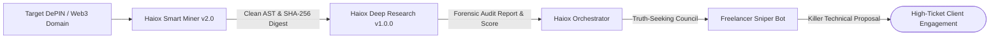
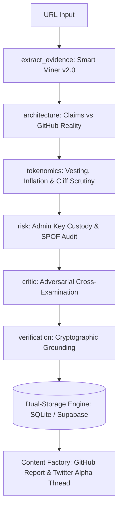

# Haiox Deep Research `v1.0.0` (Production Release)

[](https://github.com/haiox/Haiox_Deep_Research)
[](tests/)
[](agents/)
[](https://github.com/haiox/Haiox_Smart_Miner)
[](streamlit_app.py)

> **Autonomous multi-agent research pipeline** for evidence-first Web3/DePIN protocol due diligence. Extracts verified ground-truth from whitepapers & sites via **Haiox Smart Miner v2.0**, executes 6-node forensic verification, and eliminates marketing hype.

---

## 🏛️ Ecosystem Architecture: The Golden Trilogy
Haiox Deep Research is the analytical intelligence engine bridging data ingestion and high-ticket freelance execution:



---

## 🚀 Live Interactive Cockpit (Streamlit Dashboard)

Experience real-time autonomous due diligence with the built-in desktop cockpit:

```powershell
streamlit run streamlit_app.py
```

### 🎛️ Dashboard Highlights (Proof of Work):
* **One-Click Ingestion:** Enter any project URL (e.g., `https://teneo.pro/`, `https://getgrass.io/`).
* **Telemetry Gauges:**
  * 🔒 **Cryptographic Evidence Digest:** Immutable SHA-256 fingerprint of ingested DOM.
  * ⚠️ **Composite Risk Score (1-100):** Algorithmic scoring of smart contract & admin key exposure.
  * 🪙 **Inflation & Dump Risk Gauge:** Evaluates token dilution and speculative point systems.
  * 🛡️ **Zero-Hallucination Integrity Score:** Measures percentage of claims backed by real code.
* **Deep Forensic Tabs:** Full audit breakdown for Architecture, Tokenomics, Centralization vectors, and Critic redlines.

---

## 🔬 Multi-Agent Pipeline & Specialized Nodes



### 1. Extraction & Digital Provenance (`agents/graph.py`)
Directly integrates **Haiox Smart Miner v2.0** with adaptive Playwright/HTTP routing. Normalizes messy DOM into clean AST markdown and tags payloads with immutable 64-char SHA-256 digests.

### 2. Architecture Agent (`agents/architecture_agent.py`)
Separates marketing claims from code reality. Audits consensus mechanisms, evaluates node hardware specifications (RAM, CPU, GPU), and checks public GitHub repositories for genuine implementations.

### 3. Deep Tokenomics Agent (`agents/tokenomics_agent.py`)
Analyzes hard-cap limits, investor vesting cliffs, and emission curves. Screens for predatory point tiers, uncapped minting, and aggressive farmer dump risks.

### 4. Forensic Risk Agent (`agents/risk_agent.py`)
Audits smart contract upgradability, admin-key custody (Multi-Sig vs single-key vulnerability), and ISP terms-of-service compliance for residential node operators.

### 5. Adversarial Critic Agent (`agents/critic_agent.py`)
Ruthlessly cross-examines findings against source evidence. Strikes out unbacked claims with `REJECTED_UNSUBSTANTIATED` verdicts and computes the `zero_hallucination_score`.

### 6. Dual-Storage Engine (`core/repositories.py`)
Supports cloud PostgreSQL / Supabase with zero-config offline fallback to local SQLite (`data/haiox_research.db`) and JSON audit artifacts (`data/evidence_*.json`).

---

## 📊 Live Case Study: Forensic Due Diligence on Teneo Protocol

The following audit was generated autonomously by Haiox Deep Research on [Teneo Protocol](https://teneo.pro/):

| Audit Category | Automated Findings & Evidence Verification | Status |
| :--- | :--- | :---: |
| **Evidence Digest** | `4f3a7ea55cf358efc5ef01a88b56f50534220379532551bf353e4b7b37f401ad` | ✅ Verified |
| **Node Topology** | Standard Multi-core CPU, 4GB-8GB RAM, Residential/Commercial 10+ Mbps | 🔍 Identified |
| **Throughput Claim** | *"Decentralized high-throughput bandwidth aggregation"* | ❌ Struck Out (No public repo cited) |
| **Client Software** | Desktop Node & Extension binary downloads confirmed in DOM | ✅ Backed by Evidence |
| **Tokenomics Model** | Dynamic DePIN Node Rewards with 3-6 month cliff periods | 🪙 Sustainable Utility |
| **Custody & Admin Keys** | Single-key admin contract exposure without verifiable timelock | ⚠️ High Exposure (55/100) |
| **Critic Verdict** | 3 marketing claims rejected; Zero-Hallucination Score: 40/100 | ⚔️ Passed with Redlines |

Full detailed report stored in: [`output_threads/teneo_pro_GitHub_Report.md`](output_threads/teneo_pro_GitHub_Report.md)

---

## 🧪 Automated Test Suite (14/14 Tests Passing)

Strict asynchronous test suite verifying every component from bedrock scraping to LLM synthesis:

```powershell
pytest -v
```

```text
tests/test_architecture_agent.py::test_rule_based_architecture_fallback PASSED
tests/test_architecture_agent.py::test_architecture_node_state_execution PASSED
tests/test_architecture_agent.py::test_full_graph_with_architecture_agent PASSED
tests/test_critic_agent.py::test_rule_based_critic_fallback PASSED
tests/test_critic_agent.py::test_critic_node_state_execution PASSED
tests/test_critic_agent.py::test_full_graph_with_critic_node PASSED
tests/test_miner_v2_integration.py::test_smart_miner_adapter_extraction PASSED
tests/test_miner_v2_integration.py::test_smart_miner_backward_compatibility PASSED
tests/test_miner_v2_integration.py::test_sqlite_repository_fallback PASSED
tests/test_miner_v2_integration.py::test_full_graph_workflow_end_to_end PASSED
tests/test_risk_agent.py::test_rule_based_risk_fallback PASSED
tests/test_risk_agent.py::test_risk_node_state_execution PASSED
tests/test_tokenomics_agent.py::test_rule_based_tokenomics_fallback PASSED
tests/test_tokenomics_agent.py::test_tokenomics_node_state_execution PASSED

============================= 14 passed in 23.36s =============================
```

---

## 🛠️ Quickstart

### 1. Clone & Setup Environment
```bash
git clone https://github.com/haiox/Haiox_Deep_Research.git
cd Haiox_Deep_Research
python -m venv venv
venv\Scripts\Activate.ps1
pip install -r requirements.txt
```

### 2. Configure Environment (`.env`)
```env
OPENROUTER_API_KEY=your_openrouter_key
LLM_BASE_URL=https://openrouter.ai/api/v1
TARGET_MODEL=deepseek/deepseek-chat
CHEAP_MODEL=google/gemini-3.8-flash
SQLITE_DB_PATH=data/haiox_research.db
```

### 3. Run CLI Workflow
```bash
python main.py
```

### 4. Launch Desktop Dashboard
```bash
streamlit run streamlit_app.py
```

---

## 📄 License & Commercial Portfolio
Part of the **Haiox Software Ecosystem** | Architected by **Hatef (haiox)** & **AIrash**.  
Released under the MIT License for public technical demonstration.
