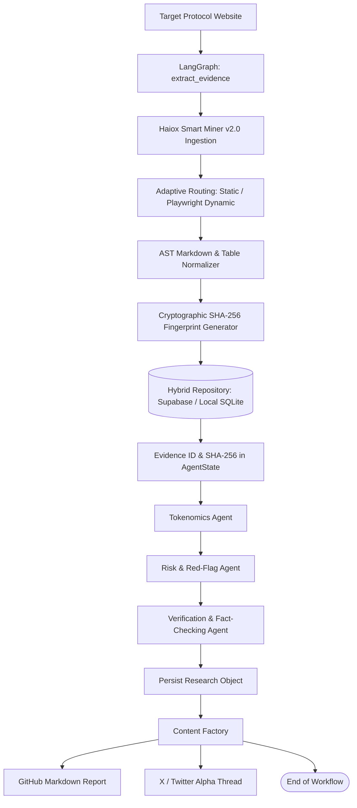

# Haiox Deep Research `v0.5.0-alpha`

[](https://github.com/haiox/Haiox_Deep_Research)
[](tests/)
[](agents/)
[](https://github.com/haiox/Haiox_Smart_Miner)

> **Autonomous multi-agent research pipeline** for evidence-first Web3/DePIN protocol investigations, backed by cryptographic SHA-256 evidence ingested directly from **Haiox Smart Miner v2.0**.

---

### 📍 Current Milestone: Day 5 Completed (Forensic Risk & Centralization Agent Activated)
* **Completed (v0.5.0):**
  * ✅ **Step 1:** Smart Miner v2.0 bedrock ingestion with SHA-256 digital provenance.
  * ✅ **Step 2:** Dual-storage architecture (Supabase / Postgres + Zero-config local SQLite fallback & disk JSON audit).
  * ✅ **Step 3:** Technical Architecture Agent (`agents/architecture_agent.py`) separating whitepaper marketing claims from actual GitHub implementation, node specs, and consensus mechanics.
  * ✅ **Step 4:** Deep Tokenomics Agent (`agents/tokenomics_agent.py`) analyzing inflation curves, vesting cliffs, utility sinks, and ponzinomics/dump risk scoring.
  * ✅ **Step 5:** Forensic Risk Agent (`agents/risk_agent.py`) auditing admin-key custody, smart contract upgradability, ISP regulatory liabilities, and issuing 1-100 composite risk scores.
  * ✅ **Automated Tests:** 11/11 integration tests passing in strict async environment (`tests/test_risk_agent.py`, `tests/test_tokenomics_agent.py`, `tests/test_architecture_agent.py`, `tests/test_miner_v2_integration.py`).
* **Active / Next Steps (Sprint to v1.0.0):**
  * 🔄 **Step 6:** Adversarial Cross-Critic Agent (`agents/critic_agent.py`).
  * 🔄 **Step 7:** Production Release v1.0.0 & X Thread Engine (@haioxlab).

## Architecture & Capabilities

- **Direct Smart Miner v2.0 Bedrock Integration**: Replaced ad-hoc scrapers with Smart Miner v2.0 (`route()`), enabling static/dynamic crawler routing, AST clean markdown normalization, table extraction, and zero-hallucination source capture.
- **Digital Evidence Layer (SHA-256 Provenance)**: Every research session computes cryptographic SHA-256 digests over ingested DOM payloads.
- **Dual-Storage Engine**: Seamless hybrid persistence supporting PostgreSQL / Supabase with automatic, zero-config local SQLite (`data/haiox_research.db`) and JSON audit fallback.
- **Multi-Agent LangGraph State Machine**: Orchestrates Tokenomics, Risk, Claim Verification, Database Persistence, and Content Factory.
- **Zero Hallucination Fact-Checking**: Verification Agent cross-examines analytical claims directly against AST source evidence and quotes authentic provenance.
- **Content Factory**: Automatically publishes comprehensive GitHub Markdown reports and 4-tweet alpha threads.

## 1. Architecture Flow



> The diagram includes both outgoing paths currently registered from `persist_research`: a direct `END` edge and an edge to `twitter_factory`. This reflects the graph definition in the repository rather than an inferred design.

## 4. Core Features

### Live DePIN website acquisition

The adapter uses `curl_cffi.requests.AsyncSession` with Chrome 120 impersonation and a 30-second timeout. It accepts a project URL, checks for an HTTP 200 response, and extracts page content.

### HTML cleanup and text normalization

BeautifulSoup removes `script`, `style`, `nav`, `footer`, `noscript`, `header`, and `aside` elements. The remaining text is flattened and converted to ASCII before LLM processing.

### Dual-model LLM routing

`core/llm_router.py` routes calls through an OpenAI-compatible endpoint:

- `cheap` role: `z-ai/glm-5.3-flash` by default;
- `main` role: `deepseek/deepseek-v4-flash-0731` by default;
- default gateway: OpenRouter.

The worker model prepares extracted website content. The main model performs tokenomics analysis, risk analysis, verification, and content generation.

### Evidence-first persistence

Extracted content is stored before downstream analysis. Specialist agents receive an evidence ID and retrieve the associated record from PostgreSQL when needed.

### Tokenomics Agent

The Tokenomics Agent requests a JSON object containing available token details such as token name, total supply, utility, and distribution. Parsing failures are preserved as structured error findings.

### Risk Agent

The Risk Agent asks the main model to identify technical, economic, centralization, and red-flag risks from stored evidence. Its response is parsed as JSON and added to the shared structured findings.

### Verification Agent

The Verification Agent condenses the tokenomics findings and selected technical risks/red flags, then evaluates three major claims against the stored evidence. Its expected result includes:

- claim text;
- `supported`, `partially_supported`, or `unsupported` status;
- confidence score; and
- a short source quote.

If model output cannot be parsed, the current implementation returns a rule-based fallback verification result.

### Research persistence

The persistence node writes tokenomics, risk analysis, and verification JSON to the `research_reports` table, linked to the evidence record.

### Content Factory

The Content Factory converts structured research into two freelance- and portfolio-oriented deliverables:

1. an English investigative X/Twitter thread; and
2. a GitHub Markdown report containing tokenomics, risk analysis, and verification sections.

Thread generation includes a simplified retry prompt when the primary LLM response is empty.

## 5. Pipeline

```text
Target URL
  -> live page acquisition
  -> HTML cleanup and text normalization
  -> worker-model content preparation
  -> evidence persistence
  -> Tokenomics Agent
  -> Risk Agent
  -> Verification Agent
  -> verified research persistence
  -> Content Factory
  -> Markdown report + X/Twitter thread
```

The current LangGraph node order is:

```text
extract_evidence
  -> tokenomics
  -> risk
  -> verification
  -> persist_research
  -> twitter_factory
  -> END
```

The graph file also contains a direct `persist_research -> END` edge.

## 6. Technology Stack

| Area | Repository implementation |
|---|---|
| Language | Python |
| Workflow orchestration | LangGraph |
| LLM integration | LangChain OpenAI-compatible `ChatOpenAI` |
| LLM gateway | OpenRouter-compatible endpoint |
| Worker model | `z-ai/glm-5.3-flash` default |
| Main model | `deepseek/deepseek-v4-flash-0731` default |
| Web acquisition | `curl_cffi` with Chrome impersonation |
| HTML parsing | BeautifulSoup |
| Database | PostgreSQL / Supabase connection via `DATABASE_URL` |
| Database driver | `psycopg2` |
| Vector extension | pgvector is enabled by the setup script |
| Graph state | Python `TypedDict` |
| Structured interchange | JSON |
| Content outputs | Markdown and plain-text X/Twitter threads |

The database setup creates `projects`, `evidence`, and `whitepaper_claims`. The current pipeline additionally writes to `research_reports`; creation of that table is not present in `database/db_setup.py` and must already exist in the connected database.

## 7. Project Structure

```text
DePIN_Research_Agent/
├── agents/
│   ├── graph.py                # LangGraph nodes, edges, and compilation
│   ├── state.py                # Shared graph-state contract
│   ├── tokenomics_agent.py     # Token and reward analysis
│   ├── risk_agent.py           # Technical, economic, and centralization risks
│   ├── verification_agent.py   # Claim-to-evidence verification
│   ├── persist_agent.py        # Final research-object persistence
│   └── twitter_agent.py        # Content Factory and output generation
├── core/
│   ├── llm_router.py           # Worker/main model selection
│   └── repositories.py         # Evidence and report database operations
├── database/
│   └── db_setup.py             # PostgreSQL tables and pgvector setup
├── tools/
│   └── smart_miner_adapter.py  # Live acquisition and content preparation
├── output_threads/             # Recorded reports and social threads
├── check_db.py                 # Reads the latest three evidence records
├── main.py                     # Current executable entry point
├── requirements.txt            # Declared Python dependencies
└── README.md
```

## 8. Execution / Usage

### Prerequisites

- Python
- a reachable PostgreSQL/Supabase database;
- an OpenRouter-compatible API key; and
- network access to the target project website and LLM gateway.

The exact supported Python version is **not documented in the current repository**.

### Install declared dependencies

```bash
python -m venv venv
```

Windows PowerShell:

```powershell
venv\Scripts\Activate.ps1
pip install -r requirements.txt
```

`tools/smart_miner_adapter.py` imports `curl_cffi`, but `curl_cffi` is not currently declared in `requirements.txt`. Install it separately for the current code:

```powershell
pip install curl-cffi
```

### Environment variables

Create a local `.env` file in the project root with these variable names:

```env
OPENROUTER_API_KEY=your_key
LLM_BASE_URL=https://openrouter.ai/api/v1
TARGET_MODEL=deepseek/deepseek-v4-flash-0731
CHEAP_MODEL=z-ai/glm-5.3-flash
DATABASE_URL=your_postgresql_connection_string
```

Do not commit credentials.

### Initialize the database

```powershell
python database/db_setup.py
```

This creates the `projects`, `evidence`, and `whitepaper_claims` tables and enables pgvector. The pipeline also expects:

- an existing project record with ID `1`; and
- an existing `research_reports` table compatible with the insert in `core/repositories.py`.

The schema or migration for `research_reports` was **not found in the current repository**.

### Select a target

The current target is defined directly in `main.py`:

```python
target_url = "https://teneo.pro/"
```

A CLI argument, web interface, or external configuration mechanism for selecting the target was **not found in the current repository**.

### Run the workflow

From the project root:

```powershell
python main.py
```

Generated content is written to:

```text
output_threads/<domain>_GitHub_Report.md
output_threads/<domain>_thread.txt
```

### Inspect recent evidence

```powershell
python check_db.py
```

This prints the latest three records from the `evidence` table.

## 9. Current Status & Roadmap (Sprint Progress)

The repository is actively evolving through daily focused sprints toward **v1.0.0**. Currently at **v0.2.0-alpha**:

- [x] **Step 1: Smart Miner v2.0 Bedrock Connection** — Clean markdown, AST table normalizer, and 64-char SHA-256 evidence digests.
- [x] **Step 2: Dual Storage & Offline Resilience** — Supabase/PostgreSQL with automatic local SQLite (`data/haiox_research.db`) and JSON evidence file fallback.
- [x] **Step 3: Technical Architecture Agent** (`agents/architecture_agent.py`) — Deep fact-checking comparing whitepaper marketing claims against actual GitHub repositories, node hardware requirements, and consensus topology.
- [x] **Step 4: Deep Tokenomics Agent** (`agents/tokenomics_agent.py`) — Inflation curves, vesting cliff periods, real utility sinks, and ponzinomics/dump risk scoring.
- [x] **Step 5: Forensic Risk Agent** (`agents/risk_agent.py`) — Admin key privilege audits, centralization vectors, ISP regulatory liabilities, and 1-100 composite risk scoring.
- [x] **Automated Validation** — Pytest suite covering extraction, legacy adapter fallback, SQLite persistence, architecture separation, deep tokenomics audit, forensic risk analysis, and full LangGraph workflow (`11 passed in 25s`).
- [ ] **Step 6 (Next Priority): Adversarial Cross-Critic Agent** (`agents/critic_agent.py`) — Fact-checking cross-examination and hallucination elimination.
- [ ] **Step 5: Centralization & Smart Contract Risk Agent** — Admin key privilege audits and 1-100 risk scoring.
- [ ] **Step 6: Adversarial Critic Agent** — Uncompromising cross-verification between findings.
- [ ] **Step 7: Production Release v1.0.0 & X Thread Engine** — Automated executive Markdown reports and 280-char technical X/Twitter drops for `@haioxlab`.

## 10. Future Scope

The previous README documented the following future directions; they are not implemented as current features:

- a Promoter Agent for evidence-grounded positive project analysis;
- additional specialized research agents;
- additional verification strategies;
- richer research objects;
- additional professional output formats; and
- expanded DePIN project coverage.

No implementation schedule is documented in the current repository.

## Existing Research Artifacts

The repository includes paired Markdown and X/Twitter outputs in `output_threads/` for four DePIN projects. These files provide concrete portfolio examples for freelance research, technical due diligence, risk analysis, and content-generation work.

## Portfolio Context

Haiox DePIN Research Agent is the third project in a three-project Haiox portfolio:

1. Telegram bot project;
2. Haiox Smart Miner; and
3. Haiox DePIN Research Agent.

Smart Miner provides extraction capability. This repository adds evidence persistence, specialist analysis, verification, and the Content Factory required to turn research into client-facing deliverables.

---

**Evidence first. Analyze second. Verify third. Publish last.**
