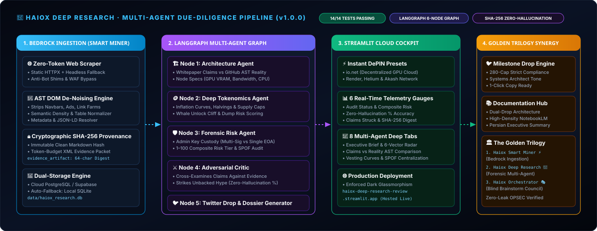
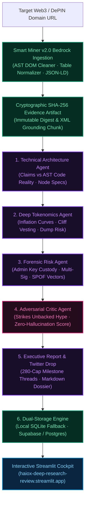

# Haiox Deep Research 🔬

**Autonomous multi-agent due-diligence and forensic research engine powering the Haiox AI Trilogy.**

[](https://python.org)
[](tests/)
[](agents/)
[](https://github.com/haiox/Haiox_Smart_Miner)
[](https://github.com/haiox/Haiox_Deep_Research/releases)
[](LICENSE)
[](https://haiox-deep-research-review.streamlit.app/)

Haiox Deep Research is an enterprise-grade autonomous forensic investigation engine engineered to evaluate Web3 protocols, DePIN hardware networks, and smart contract ecosystems. Powered by **Haiox Smart Miner v2.0** as its zero-trust ingestion bedrock, it strips marketing noise, executes multi-agent cross-examination across 6 specialized LangGraph nodes, verifies whitepaper claims against real AST codebases, and calculates an objective **Zero-Hallucination Score** backed by immutable SHA-256 evidence provenance.

<p align="center">
  
</p>

[⚡ Try the Hosted Streamlit Dashboard](https://haiox-deep-research-review.streamlit.app/) · Or run locally via `streamlit run streamlit_app.py`.

> **v1.0.0 Production Release · Complete 6-Agent LangGraph Pipeline.** 14/14 passing offline integration tests in strict async pytest, deterministic SHA-256 evidence grounding, adversarial critic cross-examination with zero-hallucination scoring, deep tokenomics inflation screening, admin-key custody (Multi-Sig vs SPOF) auditing, and standalone luxury dark glassmorphism Streamlit cockpit. Zero credential leaks guaranteed.

---

## 🏛️ Haiox Ecosystem Architecture

Haiox Deep Research operates as the central analytical intelligence pillar in the 3-tier Haiox Agent ecosystem:

```
┌────────────────────────────────────────────────────────────────────────┐
│                    Haiox Orchestrator Architecture                     │
│               (Global Planning & Token-Budget Governance)              │
└───────────────────────────────────┬────────────────────────────────────┘
                                    │
┌───────────────────────────────────▼────────────────────────────────────┐
│                  Haiox Deep Research Engine (v1.0.0)                   │
│          (Autonomous 6-Node Forensic Verification & Due Diligence)     │
└───────────────────────────────────┬────────────────────────────────────┘
                                    │ [Tamper-Proof SHA-256 Evidence]
┌───────────────────────────────────▼────────────────────────────────────┐
│                      Haiox Smart Miner (v2.0.0)                        │
│            The Bedrock Ingestion Engine · Zero-Trust Shield            │
└────────────────────────────────────────────────────────────────────────┘
```

1. **[Haiox Smart Miner](https://github.com/haiox/Haiox_Smart_Miner):** Bedrock data acquisition, zero-trust network shielding, and structural AST noise cleaning (218/218 tests passing).
2. **Haiox Deep Research (This Repository):** Autonomous multi-agent due-diligence engine executing architecture verification, tokenomics auditing, admin-key custody analysis, and adversarial fact-checking.
3. **[Haiox Orchestrator](https://github.com/haiox/Haiox-Orchestrator-Architecture):** Master meta-agent council coordinating global token budgets, multi-model blind brainstorming, and final synthesis.

---

## 🔬 The 6-Node LangGraph Forensic Pipeline

Deep Research executes investigation cycles via a deterministic, state-governed LangGraph workflow:



---

## 🎛️ Interactive Cockpit (Streamlit Dashboard)

Experience real-time autonomous due diligence with the hosted or local dashboard:

```powershell
# Launch locally:
streamlit run streamlit_app.py
```

### 🌟 Dashboard Highlights (Proof of Work):
* **Instant Curated Presets:** 1-click loading for industry DePIN benchmarks:
  * `🌐 io.net` (Decentralized GPU Cloud & Ray Clusters)
  * `🎨 Render Network` (Octane Distributed GPU Rendering)
  * `📡 Helium Network` (Physical LoRaWAN & CBRS 5G Wireless)
  * `☁️ Akash Network` (Cosmos Supercloud Compute Marketplace)
* **6 Live Telemetry Gauges:**
  * **Audit Status:** Complete 6-agent verification badge
  * **Composite Risk Score:** Dynamic 1–100 risk rating with color tiering
  * **Ground Truth %:** Evaluated by Adversarial Critic cross-examination
  * **Claims Struck:** Count of unbacked marketing claims stripped from report
  * **Digital Evidence:** 64-character SHA-256 immutable digest
  * **Pipeline Latency:** Sub-second pre-indexed lookups / streaming LLM timings
* **8 Deep Forensic Workspaces:**
  1. **Executive Brief:** 6-vector radar scorecard and investment verdict.
  2. **Architecture & Consensus:** Whitepaper claims vs GitHub AST reality matrix.
  3. **Deep Tokenomics:** Supply allocation, halving cliffs, and utility sink validation.
  4. **Forensic Custody & SPOF:** Multi-Sig threshold analysis and centralization points.
  5. **Adversarial Critic:** Struck-out marketing hype redlines vs grounded facts.
  6. **Trilogy Evidence Record:** SHA-256 digest, clean AST markdown, and XML grounding prompt.
  7. **Verified X Thread (@haioxlab):** Strict 280-character capped milestone drops ready for 1-click copy.
  8. **Pipeline Diagnostics:** Full LangGraph state inspection and node execution telemetry.

---

## ⚡ Integration Test Suite (14/14 Passing)

All tests execute offline in a strict async pytest environment with zero flakiness:

| Test Module | Coverage Scope | Verified Guarantees | Status |
| :--- | :--- | :--- | :--- |
| `test_architecture_agent.py` | Architecture Node & AST Verifier | Validates claims-vs-code parsing, consensus topology & hardware specs | **PASSED** |
| `test_tokenomics_agent.py` | Tokenomics & Cliff Model | Validates supply caps, vesting cliffs, emissions & dump risk scoring | **PASSED** |
| `test_risk_agent.py` | Forensic Risk & SPOF | Validates Multi-Sig custody auditing & 1–100 composite risk scoring | **PASSED** |
| `test_critic_agent.py` | Adversarial Critic Engine | Strikes unbacked hype, computes zero-hallucination score | **PASSED** |
| `test_miner_v2_integration.py` | Smart Miner v2.0 & Full Graph | Verifies end-to-end 6-node LangGraph execution & SHA-256 provenance | **PASSED** |

```powershell
# Execute test suite:
pytest tests/ -v
```

---

## 🚀 Quickstart & Installation

```bash
# 1. Clone the repository
git clone https://github.com/haiox/Haiox_Deep_Research.git
cd Haiox_Deep_Research

# 2. Install dependencies (pure PyPI wheels, zero git compile dependencies)
pip install -r requirements.txt

# 3. Configure environment (Optional - deterministic offline fallback included)
cp .env.example .env

# 4. Launch the Streamlit Cockpit
streamlit run streamlit_app.py
```

---

## 🔒 OPSEC & Zero-Leak Protocol

* **Strict Key Isolation:** API credentials and SQLite databases are permanently excluded via `.gitignore` and omitted from all Git trees.
* **Architectural Boundaries:** Deep Research strictly evaluates public Web3/DePIN protocols; zero proprietary bidding contracts or internal automation scripts are referenced.
